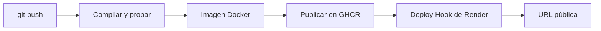

# Entrega final: ciclo completo CI/CD

**Repositorio:** https://github.com/julianpulidoc/acm_ecommerce_java_avanzado

**Pipeline:** https://github.com/julianpulidoc/acm_ecommerce_java_avanzado/actions

**Equipo:** [@julianpulidoc](https://github.com/julianpulidoc) · [@Julsanchezc](https://github.com/Julsanchezc) · [@dsantiag0g](https://github.com/dsantiag0g)

## Descripción

Automatizamos el ciclo de vida de una API de e-commerce: un `git push` a `main` compila, prueba, publica una imagen Docker y dispara el despliegue en la nube sin intervención manual.

**Tecnologías:** Spring Boot 4, Java 25, PostgreSQL, Docker, GitHub Actions, GHCR y Render (opción estándar PaaS).

## Flujo

1. **CI:** GitHub Actions levanta un PostgreSQL temporal y ejecuta `./gradlew clean build`, que compila y corre la prueba de integración.
2. **Artefacto:** construye la imagen con el SHA del commit y la publica en GHCR con los tags `<sha>` y `latest`.
3. **CD:** si todo pasó y la rama es `main`, llama al Deploy Hook de Render.
4. **Verificación:** la página `/` y el endpoint `/version` muestran el texto y el commit de la versión en ejecución.

Si un paso falla, los de publicación y despliegue no se ejecutan.

## Cambios principales

| Commit | Cambio |
|---|---|
| [`6bf0cd0`](https://github.com/julianpulidoc/acm_ecommerce_java_avanzado/commit/6bf0cd0) | Java 25 en la imagen, springdoc 3, configuración por variables de entorno y docker compose completo |
| [`46aeee4`](https://github.com/julianpulidoc/acm_ecommerce_java_avanzado/commit/46aeee4) | Página de demo, endpoint `/version` y seguridad por lista blanca |
| [`0b02d04`](https://github.com/julianpulidoc/acm_ecommerce_java_avanzado/commit/0b02d04) | Despliegue continuo hacia Render |
| [`6ae077f`](https://github.com/julianpulidoc/acm_ecommerce_java_avanzado/commit/6ae077f) | Dockerfile multi-stage |
| [`978e5c3`](https://github.com/julianpulidoc/acm_ecommerce_java_avanzado/commit/978e5c3) | SHA real del commit en producción |

## Decisiones técnicas

- **Imagen multi-stage:** compila con JDK 25 y entrega solo el JRE y el JAR, con un usuario sin privilegios.
- **Trazabilidad:** cada imagen lleva el SHA de su commit, visible en `/version`.
- **Memoria:** `-XX:MaxRAMPercentage=75` para contenedores de 512 MB.
- **Secretos:** las credenciales de CI y el Deploy Hook se guardan en GitHub Secrets; GHCR usa el `GITHUB_TOKEN` de cada ejecución.

## Evidencias

| Requisito | Evidencia |
|---|---|
| Disparo automático y pruebas | [Ejecución 45490791676](https://github.com/julianpulidoc/acm_ecommerce_java_avanzado/actions/runs/45490791676): evento `push`, `BUILD SUCCESSFUL`, 0 fallos, 1 min 58 s |
| Imagen publicada | `ghcr.io/julianpulidoc/acm_ecommerce_java_avanzado`, tags `978e5c3…` y `latest` con el mismo digest |
| Despliegue automático | Render respondió HTTP 200 (`dep-dc3020rl550s73cdbup0`) |
| Imagen funcional | Ejecutada en local desde GHCR con 512 MB: `/` y `/version` responden 200 con el commit correcto |

## Demostración

1. Cambiar `app.message` en `src/main/resources/application.yaml`.
2. `git add -u && git commit -m "demo: cambio en vivo" && git push`
3. Mostrar en Actions las pruebas, la imagen publicada y el despliegue.
4. Recargar la URL pública y comparar el commit de `/version` con `git rev-parse HEAD`.

**Ejecución local:** `docker compose up -d --build` y abrir http://localhost:8080
