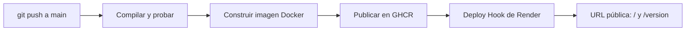

# Entrega final: ciclo completo CI/CD

**Repositorio:** https://github.com/julianpulidoc/acm_ecommerce_java_avanzado

**Aplicación desplegada:** `PEGAR_URL_DE_RENDER`

| Recurso | Enlace |
|---|---|
| Pipeline (GitHub Actions) | https://github.com/julianpulidoc/acm_ecommerce_java_avanzado/actions |
| Workflow | https://github.com/julianpulidoc/acm_ecommerce_java_avanzado/blob/main/.github/workflows/build-java.yml |
| Última ejecución exitosa revisada | https://github.com/julianpulidoc/acm_ecommerce_java_avanzado/actions/runs/45490791676 |
| Imagen Docker (GHCR, pública) | `ghcr.io/julianpulidoc/acm_ecommerce_java_avanzado` |

## Equipo

| Integrante | Usuario de GitHub |
|---|---|
| Julian David Pulido Carreño | [@julianpulidoc](https://github.com/julianpulidoc) |
| `NOMBRE` | [@Julsanchezc](https://github.com/Julsanchezc) |
| `NOMBRE` | [@dsantiag0g](https://github.com/dsantiag0g) |

## 1. Descripción

Automatizamos el ciclo de vida de una API de e-commerce: un `git push` a `main` compila, prueba, publica una imagen Docker y despliega en Render sin intervención manual. Elegimos la **opción estándar (PaaS, Render)**.

| Componente | Tecnología |
|---|---|
| Aplicación | Spring Boot 4.0.5, Java 25, Gradle 9.4.1 |
| Base de datos | PostgreSQL |
| CI/CD | GitHub Actions |
| Contenedores | Docker (multi-stage, JRE 25 Alpine) |
| Registro de imágenes | GitHub Container Registry (GHCR) |
| Nube | Render |

## 2. Flujo del pipeline



El workflow tiene un job (`build`) con pasos en secuencia. Si uno falla, los pasos de publicación y despliegue no se ejecutan.

| Etapa | Qué hace |
|---|---|
| Preparación | Descarga el código, configura Java y la caché de Gradle |
| Base de datos | Levanta un PostgreSQL 16 temporal en Docker |
| Compilación y pruebas | Ejecuta `./gradlew clean build` contra ese PostgreSQL |
| Artefactos | Guarda el reporte de pruebas y el JAR por 14 días |
| Imagen | Construye la imagen con `--build-arg GIT_SHA=<commit>` |
| Publicación | Sube a GHCR los tags `<sha del commit>` y `latest` |
| Despliegue (solo `main`) | Llama al Deploy Hook de Render y comprueba la respuesta HTTP |

La imagen de GHCR y el despliegue de Render salen del mismo commit y del mismo `Dockerfile`, pero son construcciones separadas: Render compila desde el repositorio.

## 3. Cambios realizados

| Commit | Autor | Cambio |
|---|---|---|
| [`6bf0cd0`](https://github.com/julianpulidoc/acm_ecommerce_java_avanzado/commit/6bf0cd0) | julianpulidoc | Java 25 en la imagen, springdoc 3.0.3, configuración por variables de entorno, servicio `app` y healthcheck en docker compose |
| [`46aeee4`](https://github.com/julianpulidoc/acm_ecommerce_java_avanzado/commit/46aeee4) | julianpulidoc | Página de demo en `/`, endpoint `/version`, una sola configuración de seguridad con lista blanca |
| [`0b02d04`](https://github.com/julianpulidoc/acm_ecommerce_java_avanzado/commit/0b02d04) | Julsanchezc | Etapa de despliegue continuo hacia Render |
| [`6ae077f`](https://github.com/julianpulidoc/acm_ecommerce_java_avanzado/commit/6ae077f) | Julsanchezc | Dockerfile multi-stage para compilar en la nube |
| [`978e5c3`](https://github.com/julianpulidoc/acm_ecommerce_java_avanzado/commit/978e5c3) | Julsanchezc | `/version` usa `RENDER_GIT_COMMIT` para mostrar el SHA real en producción |

**Problema principal resuelto:** la app se compilaba con Java 25 y la imagen usaba Java 21, por lo que no arrancaba (`UnsupportedClassVersionError`: class file 69.0 contra 65.0).

## 4. Decisiones técnicas

- **Imagen multi-stage:** compila con JDK 25 y la imagen final solo lleva el JRE y el JAR.
- **Usuario sin privilegios:** el contenedor corre como `spring`, no como root.
- **Memoria limitada:** `-XX:MaxRAMPercentage=75`, pensado para un contenedor de 512 MB.
- **Trazabilidad:** el SHA del commit queda en la imagen (`APP_COMMIT`) y se consulta en `/version`.
- **Configuración externa:** puerto y base de datos se reciben por variables de entorno.
- **Seguridad por lista blanca:** se publican `/`, `/version`, Swagger y `/api/**`; lo demás responde 403. La API queda abierta por ser una app de pruebas.

### Secretos

| Secreto (GitHub Actions) | Uso |
|---|---|
| `DB_NAME`, `DB_USER`, `DB_PASSWORD` | PostgreSQL temporal de las pruebas |
| `RENDER_DEPLOY_HOOK` | Disparar el despliegue en Render |
| `GITHUB_TOKEN` (automático) | Publicar la imagen en GHCR |

## 5. Evidencias

Ejecución [45490791676](https://github.com/julianpulidoc/acm_ecommerce_java_avanzado/actions/runs/45490791676), commit `978e5c3`, 24 de noviembre de 2026, duración 1 min 58 s:

| Requisito de la rúbrica | Evidencia |
|---|---|
| Disparo automático | Evento `push` sobre `main` |
| Pruebas en CI | `BUILD SUCCESSFUL`; 1 prueba de integración (`contextLoads`), 0 fallos |
| Imagen Docker construida | Paso *Build Docker image* exitoso |
| Publicación en el registro | Tags `978e5c3…` y `latest` con el mismo digest `sha256:5555c431…` |
| Despliegue automático | Render respondió HTTP 200 con el despliegue `dep-dc3020rl550s73cdbup0` |
| Cambio visible en la URL pública | Página `/` y `/version` en la URL de Render |

También descargamos la imagen publicada en GHCR y la ejecutamos en local con 512 MB de memoria y un PostgreSQL limpio. Arrancó en 15,3 s, usó 329 MB y respondió:

```json
{
  "message": "Versión 1 - Hola desde el pipeline CI/CD",
  "commit": "978e5c3f6dd93fc0e7839281dd96979560ba0308"
}
```

| Ruta | Código |
|---|---|
| `/`, `/version`, `/api/v1/api-docs`, `/api/v1/products` | 200 |
| `/swagger-ui.html` | 302 (redirige a Swagger UI) |
| `/actuator` (no declarada) | 403 |

## 6. Demostración en vivo

1. Mostrar la URL pública y el commit actual.
2. Cambiar `app.message` en `src/main/resources/application.yaml`.
3. Subir el cambio:
   ```bash
   git add src/main/resources/application.yaml
   git commit -m "demo: cambio de versión en vivo"
   git push origin main
   ```
4. En **Actions**, mostrar la ejecución, las pruebas y la imagen publicada.
5. En **Render**, mostrar el despliegue que inició el pipeline.
6. Recargar la URL y comprobar el texto nuevo, y que `commit` en `/version` sea el de `git rev-parse HEAD`.

## 7. Ejecución local

```bash
git clone https://github.com/julianpulidoc/acm_ecommerce_java_avanzado.git
cd acm_ecommerce_java_avanzado
docker compose up -d --build
```

- Página: http://localhost:8080/
- Versión: http://localhost:8080/version
- API (Swagger): http://localhost:8080/swagger-ui.html

## 8. Limitaciones y mejoras

- Ampliar las pruebas: hoy solo se verifica que la aplicación arranque con su base de datos.
- Agregar un smoke test que espere a que `/version` devuelva el SHA nuevo; hoy el pipeline confirma que Render aceptó el despliegue, no que terminó.
- Desplegar en Render la misma imagen publicada en GHCR.
- Separar el workflow en jobs de pruebas, imagen y despliegue.
- Configurar JDK 25 en el workflow (el paso instala el 21; Gradle compila con el 25 del toolchain).
- Publicar `latest` solo desde `main`.
